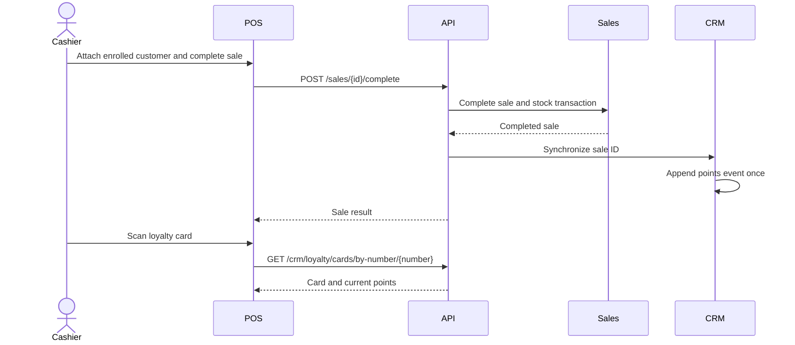

# CRM and loyalty: business MVP

## Purpose

SimpliaWear already stores customers and their sales in the Sales module. This CRM slice lets a shop recognize a returning customer at checkout and run a simple points program without duplicating customer records. The cashier can find a customer by the existing customer search or by a loyalty card number, see the balance, and issue a configured reward. The card number can be encoded as a barcode by a future printing or mobile screen; this backend does not print cards.

Retail references informed this scope: [Shopify's POS customer management](https://help.shopify.com/en/manual/sell-in-person/shopify-pos/customer-management) connects a customer profile with purchase history; [Square's loyalty accounts](https://developer.squareup.com/docs/loyalty-api/loyalty-accounts) associate one loyalty account with a customer profile; [Square's loyalty overview](https://developer.squareup.com/docs/loyalty-api/overview) describes immutable balance-changing events and return reversals. These are product examples, not SimpliaWear integrations.

## V1 workflow

1. An authorized manager configures one DZD program for the tenant. The rule is “spend X DZD to earn one point.” For example, at 100 DZD per point, a 250 DZD completed sale earns two whole points.
2. Staff enroll an active Sales customer. One customer receives one card number and starts at zero points. Card lookup works by customer ID or exact card number.
3. A completed sale earns points only if it names an enrolled customer. Draft sales and anonymous sales earn none. The points transaction records the sale ID and the earning rule used at that time. Repeating sale synchronization does not award points again.
4. A return reverses the points no longer supported by the remaining net sale amount. Each return ID is processed once. If a customer already spent those points, the balance can become negative; future earnings first offset that debt.
5. A manager configures named rewards with a positive points cost. A cashier with redemption permission issues a reward when handing it to the customer. The points debit is permanent and recorded with the reward name, user, and time. The caller supplies a redemption ID so retrying the same action does not debit again.
6. A card or reward can be deactivated without deleting its history. An inactive card cannot receive new sale points or redeem rewards. Return reversals still apply to past earnings.

## Decisions and limits for client review

- Points are whole numbers, never money. There is one DZD program per tenant and one card per customer. The program starts only after a manager configures it; no business reward rule is imposed by a seed.
- Rewards in V1 are **staff-fulfilled gifts or benefits**. Redemption does not reduce a sale total or create a payment. Coupons, automatic discounts, and gift cards require a separate POS rule and accounting design.
- No points expiry, tiers, birthday campaigns, automated SMS/email, marketing lists, or customer segmentation are included. [Square's program setup](https://api.squareup.com/help/us/en/article/3952-create-a-loyalty-program-with-square) shows these as configurable retail options; they are future decisions, not hidden defaults.
- CRM does not copy phone, email, or address. Customer search and editing remain in Sales. Marketing communications need an explicit preference and policy before implementation.
- The physical card layout, barcode label dimensions, and printable PDF remain a frontend/printing task. The backend provides a stable card number.

## Endpoints to demonstrate

See [CRM technical guide](CRM_TECHNICAL.md) for the exact routes and permissions. A demo can configure the program, enroll an existing customer, complete a named sale, scan the card number, process a return, and redeem a reward. The manager can inspect the points history at every step.
