# SimpliaDz MVP — current client workflow

This is a **backend feature draft** for discussion with the client. **Available** means the backend has the stated behavior; it does not confirm that a screen or printer workflow exists. **Partial** means part of the client's workflow is available. **Needed** means the proposed workflow has no dedicated endpoint yet. Routes marked **Proposed** are ticket ideas, not working API routes. “Remove” means soft deletion through deactivation; full deletion by an administrator is outside this MVP and will be scoped later. Guided count schedules, one-call scan results, and dedicated HR profiles are discussion ideas; confirm them before treating them as MVP requirements.

| Ticket | Feature | Backend status |
| --- | --- | --- |
| F01 | User rights and roles | Available |
| F02 | Admin user management | Available |
| F03 | Product catalog | Available |
| F04 | Customer management | Available |
| F05 | Sell products and record payment | Available |
| F06 | Sale discounts | Available |
| F07 | Open and close the cash register | Available |
| F08 | Search products by name, SKU, or barcode | Available |
| F09 | Generate a barcode | Available |
| F10 | Print barcode labels | Available |
| F11 | Consult inventory | Available |
| F12 | Print inventory documents | Available |
| F13 | Brand management | Available |
| F14 | Category management | Available |
| F15 | Purchase orders and goods receipts | Available |
| F16 | Supplier management | Available |
| F17 | Inventory analytics and warnings | Available |
| F18 | Scan a barcode for price and stock | Available |
| F19 | Physical inventory counts | Available |
| F20 | Worked-hours reporting | Needed |
| F21 | HR access to user management | Partial |
| F22 | Store and warehouse locations | Available |

## F01 — User rights and roles

**Available.** An administrator can create roles, assign permissions to roles, assign roles to users, and view a user's effective permissions. Each protected action checks the user's rights.

**Current endpoints:** `GET /permissions`; `GET /roles`; `GET /roles/{id}`; `POST /roles`; `POST /roles/{id}/permissions`; `DELETE /roles/{id}/permissions`; `POST /users/{id}/roles`; `DELETE /users/{id}/roles`; `GET /users/{id}/permissions`.

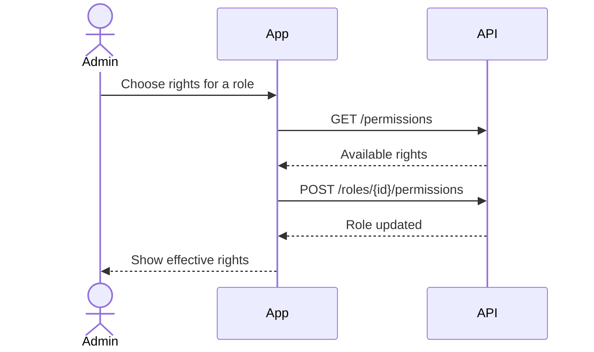

## F02 — Admin user management

**Available.** Admins can create users, list and view them, assign roles, and activate or deactivate accounts. Deactivation is the MVP's soft deletion; full deletion is deferred.

**Current endpoints:** `GET /users`; `GET /users/{id}`; `POST /users`; `POST /users/{id}/roles`; `DELETE /users/{id}/roles`; `PUT /users/{id}/activate`; `PUT /users/{id}/deactivate`.

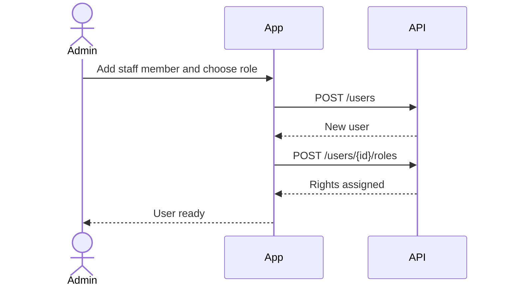

## F03 — Product catalog

**Available.** Products can be created, updated, searched, viewed, and deactivated. Sellable variants can be created, have their SKU and barcode corrected, and be deactivated. Deactivation is the MVP's soft deletion. Variant attribute combinations stay fixed so historical transactions keep their meaning.

**Current endpoints:** `GET /products?search=...`; `GET /products/{id}`; `POST /products`; `PUT /products/{id}`; `PUT /products/{id}/deactivate`; `POST /variants/products/{productId}`; `GET /variants/{id}`; `PUT /variants/{id}`; `PUT /variants/{id}/deactivate`.

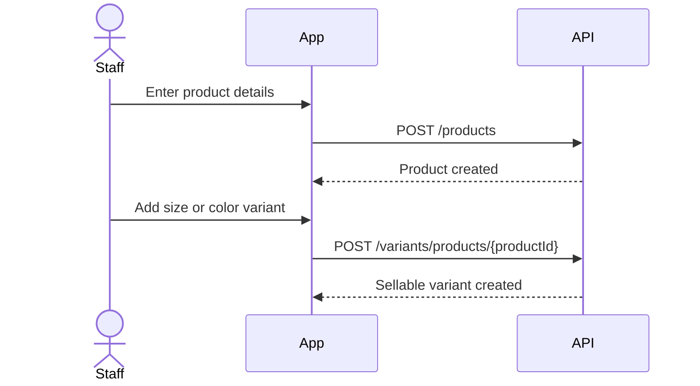

## F04 — Customer management

**Available.** Customers can be created, updated, searched, viewed, and deactivated. Past transactions keep their customer link. Deactivation is the MVP's soft deletion.

**Current endpoints:** `GET /customers?search=...`; `GET /customers/{id}`; `POST /customers`; `PUT /customers/{id}`; `PUT /customers/{id}/deactivate`.

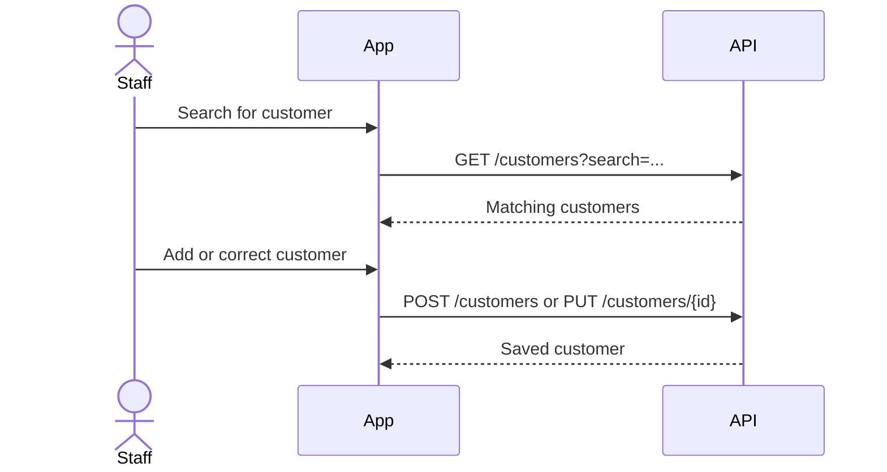

## F05 — Sell products and record payment

**Available.** A cashier can create a sale for a location, add variants by SKU or barcode, complete the sale, and record and review payments. Stock decreases when the sale is completed. A customer may be attached but is optional.

**Current endpoints:** `POST /sales`; `POST /sales/{id}/lines`; `GET /sales/{id}`; `POST /sales/{id}/complete`; `POST /sales/{saleId}/payments`; `GET /sales/{saleId}/payments`.

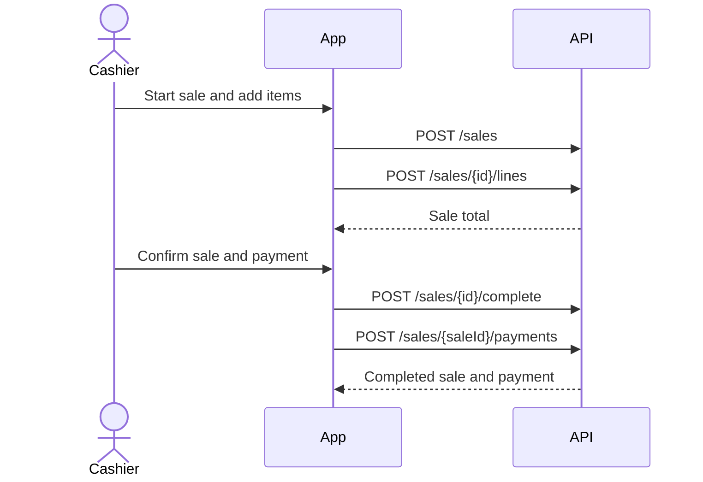

## F06 — Sale discounts

**Available.** A user with discount rights can apply a fixed or percentage discount to one line or the whole sale. The final amount is calculated by the system.

**Current endpoints:** `PUT /sales/{id}/lines/{lineId}/discount`; `PUT /sales/{id}/discount`; `POST /sales/{id}/complete`.

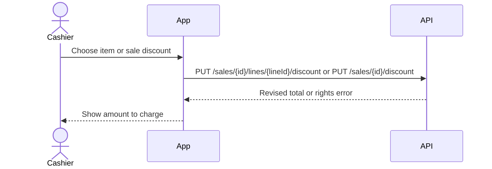

## F07 — Open and close the cash register

**Available.** A location can have several cash registers, each with one open session at a time. Several cashiers can record sales payments in the same session. The session records opening cash, cash payments, other payments, signed cash movements, counted cash at closing, and the difference. A closed register can be reopened with a new session; history remains available.

**Current endpoints:** `GET /cash-registers?locationId=...`; `POST /cash-registers`; `PUT /cash-registers/{id}`; `PUT /cash-registers/{id}/deactivate`; `POST /cash-sessions/open`; `GET /cash-sessions/current?locationId=...`; `GET /cash-sessions/{id}`; `GET /cash-sessions?locationId=...`; `POST /cash-sessions/{id}/movements`; `GET /cash-sessions/{id}/movements`; `POST /cash-sessions/{id}/close`; `POST /sales/{saleId}/payments` (with `cashSessionId`).

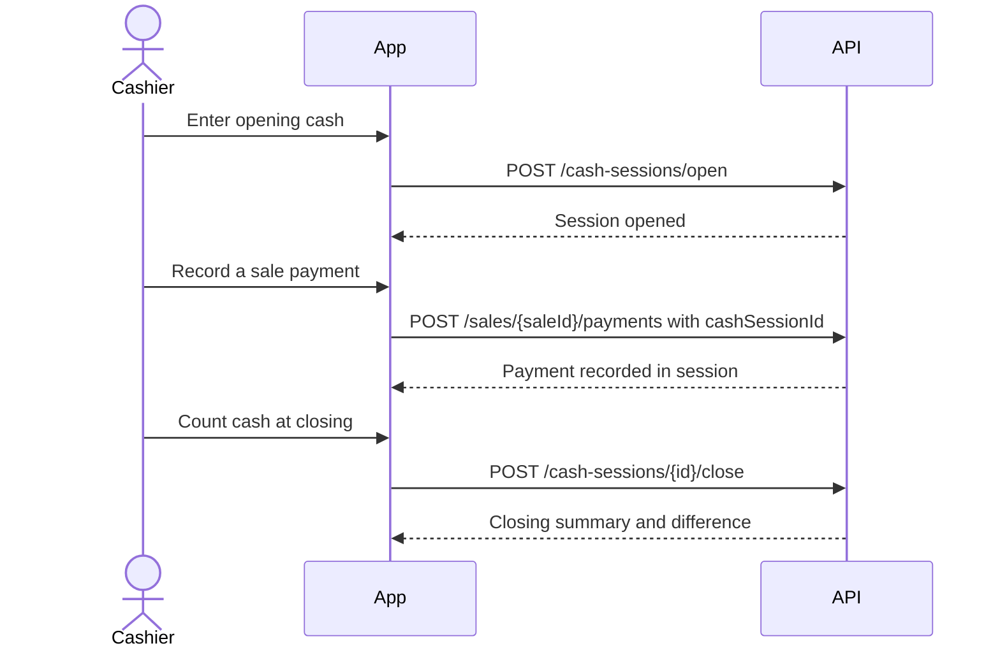

## F08 — Search products by name, SKU, or barcode

**Available.** The POS can search product names and find an exact SKU or barcode. Name search currently starts from the beginning of the name; confirm whether the client expects matches in the middle of a name.

**Current endpoints:** `GET /pos/products?search=...&priceListId=...&locationId=...`; `GET /pos/products/by-sku/{sku}?priceListId=...&locationId=...`; `GET /pos/products/by-barcode/{barcode}?priceListId=...&locationId=...`; `GET /products?search=...`.

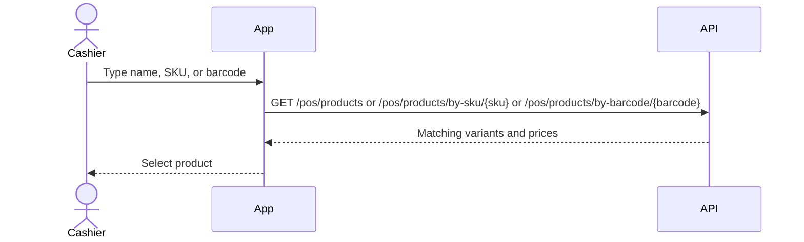

## F09 — Generate a barcode for an item

**Available.** Staff can generate a unique internal barcode for an active variant that has no barcode. The generated value uses a Code 128-compatible `SDZ` prefix followed by the variant identifier. A factory barcode is never replaced. Confirm scanner and label compatibility with the client before printing labels.

**Current endpoints:** `POST /variants/products/{productId}`; `GET /variants/by-barcode/{barcode}`.

**Current endpoint:** `POST /variants/{id}/generate-barcode`.

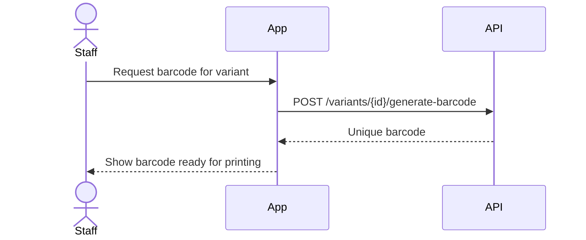

## F10 — Print barcode labels

**Available.** Authorized staff can choose variants and quantities, select a saved label template, and receive a printable HTML document with vector Code 128 barcodes. Templates are stored in the tenant database and can be created, updated, or deactivated by an authorized manager. Page and label dimensions, margins, gaps, product name, and SKU are configurable. A standard A4 90 × 40 mm template is supplied. Printer-specific layouts and prices on labels can be added later.

**Current endpoints:** `GET /barcode-label-templates`; `POST /barcode-label-templates`; `PUT /barcode-label-templates/{id}`; `PUT /barcode-label-templates/{id}/deactivate`; `POST /barcode-labels/print-document`.

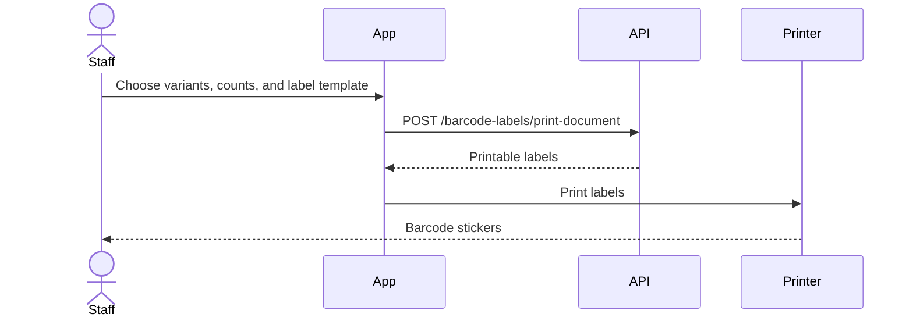

## F11 — Consult inventory

**Available.** Staff can see stock by variant or location, total stock across locations, and an inventory report that can include zero-stock variants. Low-stock and out-of-stock views are also available.

**Current endpoints:** `GET /stock/variants/{variantId}`; `GET /stock/variants/{variantId}/total`; `GET /stock/locations/{locationId}`; `GET /reports/inventory?locationId=...&includeZeroStock=...`; `GET /reports/low-stock?locationId=...`; `GET /stock/out-of-stock?locationId=...`.

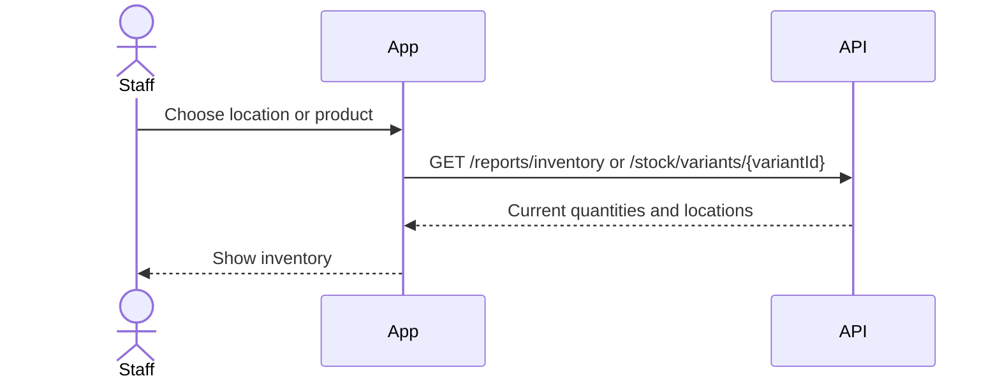

## F12 — Print inventory documents

**Available.** Authorized staff can request printable stock lists, blank physical count sheets, and completed count difference reports. Each document uses a tenant-stored template that controls title, selected columns, A4 or A3 paper, orientation, and footer text. Three standard templates are supplied. The backend returns print-ready HTML; the client app can display or print it. Movement reports and printer-specific formatting can be added later if required.

**Current endpoints:** `GET /inventory-document-templates`; `POST /inventory-document-templates`; `PUT /inventory-document-templates/{id}`; `PUT /inventory-document-templates/{id}/deactivate`; `GET /reports/inventory/document?templateId=...&locationId=...`; `GET /inventory-counts/{id}/count-sheet?templateId=...`; `GET /inventory-counts/{id}/difference-document?templateId=...`.

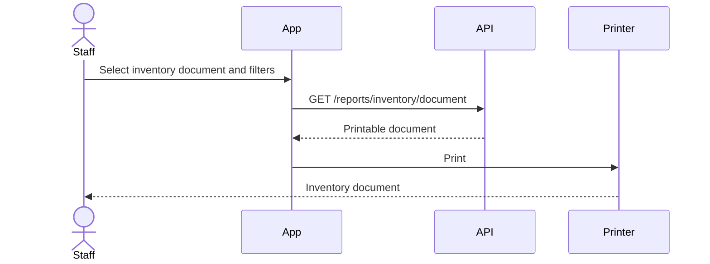

## F13 — Brand management

**Available.** Brands can be created, updated, viewed, listed, and deactivated. Products can reference a brand. Deactivation is the MVP's soft deletion.

**Current endpoints:** `GET /brands`; `GET /brands/{id}`; `POST /brands`; `PUT /brands/{id}`; `PUT /brands/{id}/deactivate`.

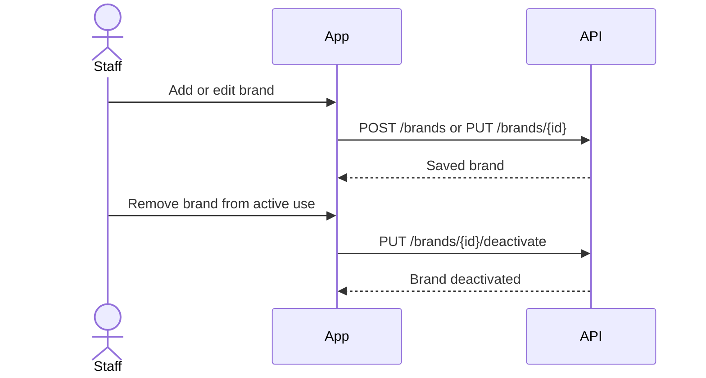

## F14 — Category management

**Available.** Categories can be created, updated, listed, viewed, organized under parent categories, and deactivated. Existing products keep their category reference. Deactivation is the MVP's soft deletion.

**Current endpoints:** `GET /categories`; `GET /categories/{id}`; `POST /categories`; `PUT /categories/{id}`; `PUT /categories/{id}/deactivate`.

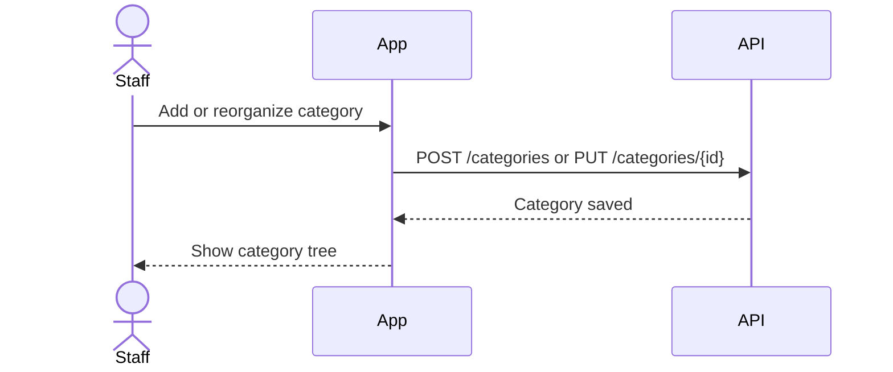

## F15 — Purchase orders and goods receipts

**Available.** Staff can create a purchase order for a supplier and destination, add variants, place or cancel the order, and receive all or part of it. Receiving updates stock; creating or placing an order does not. Confirm whether the client's “already bought products” should be entered as a purchase order followed by a receipt or through a shorter receiving flow.

**Current endpoints:** `POST /purchase-orders`; `POST /purchase-orders/{id}/lines`; `POST /purchase-orders/{id}/order`; `GET /purchase-orders/{id}`; `POST /purchase-orders/{id}/cancel`; `POST /goods-receipts`; `GET /goods-receipts/{id}`; `GET /goods-receipts/by-purchase-order/{purchaseOrderId}`.

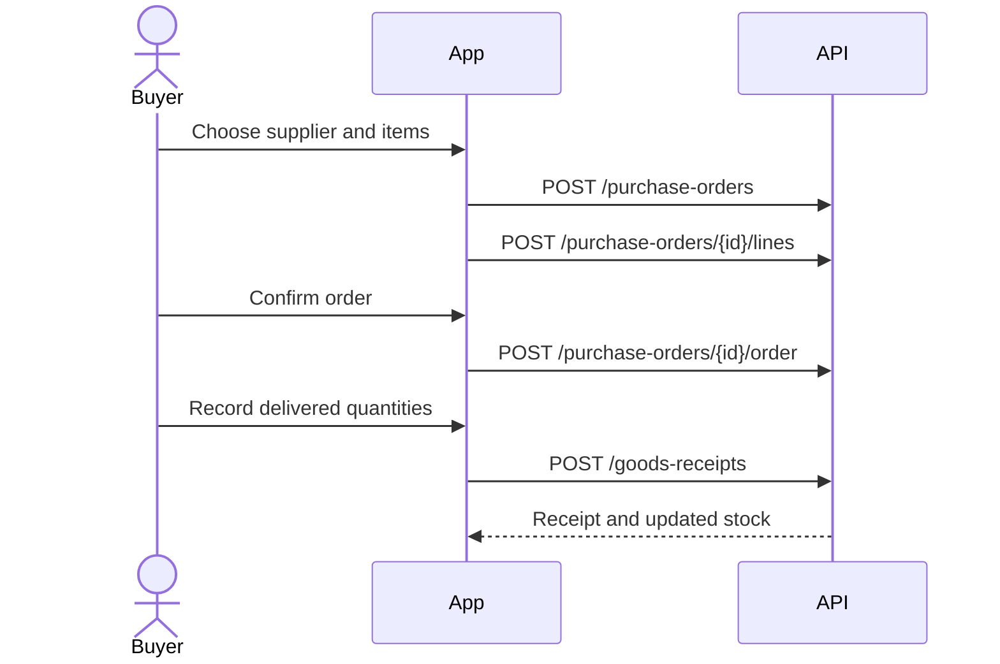

## F16 — Supplier management

**Available.** Suppliers can be created, updated, searched, viewed, and deactivated. Past purchases keep their supplier reference. Deactivation is the MVP's soft deletion.

**Current endpoints:** `GET /suppliers?search=...`; `GET /suppliers/{id}`; `POST /suppliers`; `PUT /suppliers/{id}`; `PUT /suppliers/{id}/deactivate`.

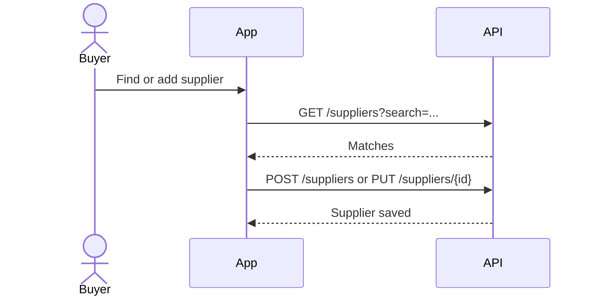

## F17 — Inventory analytics and warnings

**Available.** The backend ranks products by quantity or revenue sold, shows variant performance and today's summary, and stores low-stock and ageing warnings. A configurable backend job checks the tenant's inventory on a schedule. Each variant/location ages from the first stock entry after its balance was last zero; replenishing after a zero balance starts a new age period. The warning threshold and run interval are configurable.

**Current endpoints:** `GET /reports/products/performance?fromDate=...&toDate=...&rankBy=Quantity`; `GET /reports/products/{productId}/variants?fromDate=...&toDate=...`; `GET /reports/low-stock`; `GET /reports/dashboard/today`; `GET /inventory-warnings`; `GET /inventory-warnings/settings`; `PUT /inventory-warnings/settings`; `POST /inventory-warnings/run`.

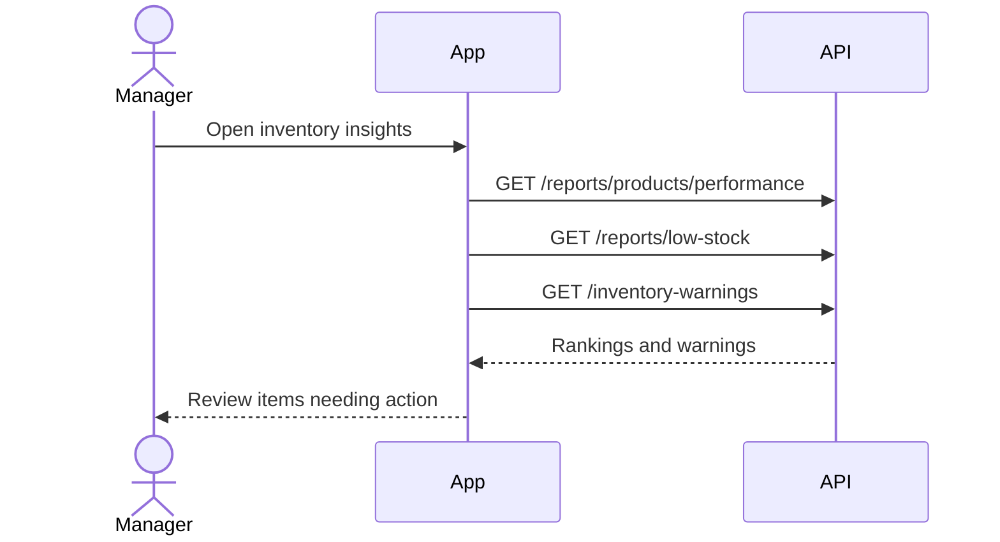

## F18 — Scan a barcode for price and stock

**Available.** Exact barcode lookup and POS price lookup exist. The POS lookup can include stock for a selected location, and a second request can show quantities across locations. A scanner can supply the barcode as input. Confirm whether the client normally needs all locations or only the current store.

**Current endpoints:** `GET /pos/products/by-barcode/{barcode}?priceListId=...&locationId=...`; `GET /variants/by-barcode/{barcode}`; `GET /stock/variants/{variantId}`.

**Proposed only if one lookup is required:** `GET /products/by-barcode/{barcode}/availability?priceListId=...`.

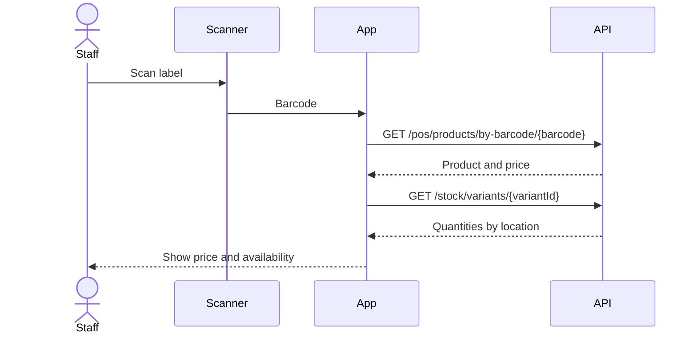

## F19 — Physical inventory counts

**Available.** Staff can start a count for a location, add variants, enter counted quantities, see differences, complete or cancel the count, and review count history. Completion reconciles stock through adjustments. Count sheets and difference documents can be printed. Monthly, half-yearly, and yearly guided plans are deferred beyond this MVP.

**Current endpoints:** `POST /inventory-counts`; `POST /inventory-counts/{id}/lines`; `PUT /inventory-counts/{id}/lines/{productVariantId}/count`; `GET /inventory-counts/{id}`; `GET /inventory-counts?locationId=...`; `POST /inventory-counts/{id}/complete`; `POST /inventory-counts/{id}/cancel`; `GET /inventory-counts/{id}/count-sheet?templateId=...`; `GET /inventory-counts/{id}/difference-document?templateId=...`.

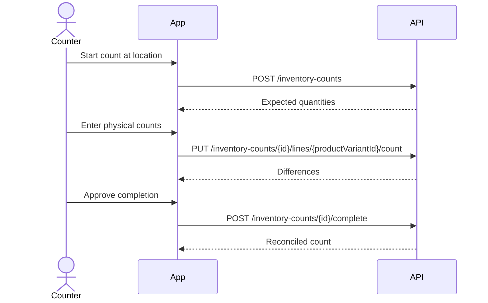

## F20 — Worked-hours reporting

**Needed.** There is no staff clock-in, clock-out, shift correction, or worked-hours report. Define how breaks, overnight shifts, absences, manual corrections, and approval work before calculating daily, monthly, or yearly totals.

**Proposed endpoints:** `POST /work-sessions/clock-in`; `POST /work-sessions/{id}/clock-out`; `GET /work-sessions?userId=...&fromDate=...&toDate=...`; `PUT /work-sessions/{id}`; `GET /reports/work-hours?userId=...&fromDate=...&toDate=...`.

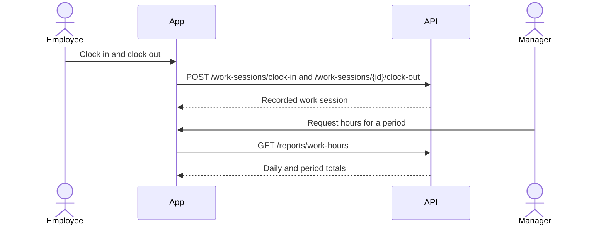

## F21 — HR access to user management

**Partial.** The existing user and role endpoints can create staff accounts and deactivate them, with rights controlling access. There is no dedicated HR staff profile, employment lifecycle, or separate HR-specific access setup. Confirm which user-management actions an HR manager may perform without full administrator rights.

**Current endpoints:** `GET /users`; `POST /users`; `PUT /users/{id}/deactivate`; `PUT /users/{id}/activate`; `POST /users/{id}/roles`; `GET /roles`; `GET /permissions`.

**Proposed only if HR records are required:** `GET /staff`; `POST /staff`; `PUT /staff/{id}`.

```mermaid
sequenceDiagram
    actor HR
    participant App
    participant API
    HR->>App: Add or deactivate staff account
    App->>API: POST /users or PUT /users/{id}/deactivate
    API-->>App: Account result or rights error
    App-->>HR: Show updated staff list
```

## F22 — Store and warehouse locations

**Available.** Admins can create, update, list, view, and deactivate stores or warehouses. Stock and sales use locations. Deactivation is the MVP's soft deletion.

**Current endpoints:** `GET /locations`; `GET /locations/{id}`; `POST /locations`; `PUT /locations/{id}`; `PUT /locations/{id}/deactivate`.

```mermaid
sequenceDiagram
    actor Admin
    participant App
    participant API
    Admin->>App: Add store or warehouse
    App->>API: POST /locations
    API-->>App: New location
    Admin->>App: Update or deactivate location
    App->>API: PUT /locations/{id} or PUT /locations/{id}/deactivate
    API-->>App: Location updated
```
